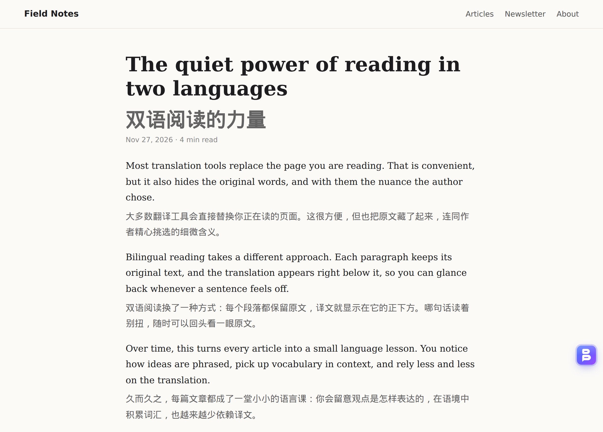
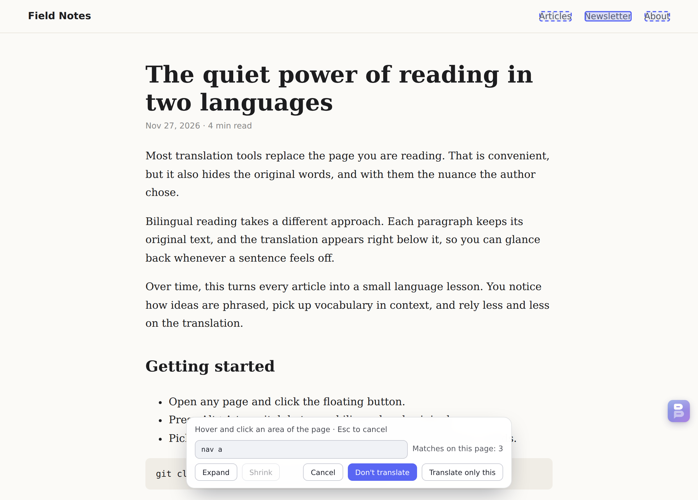
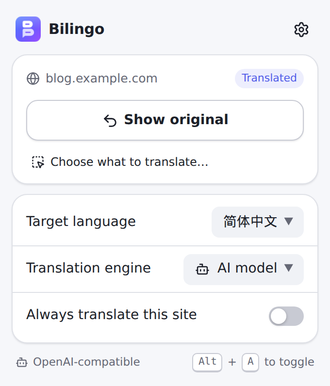
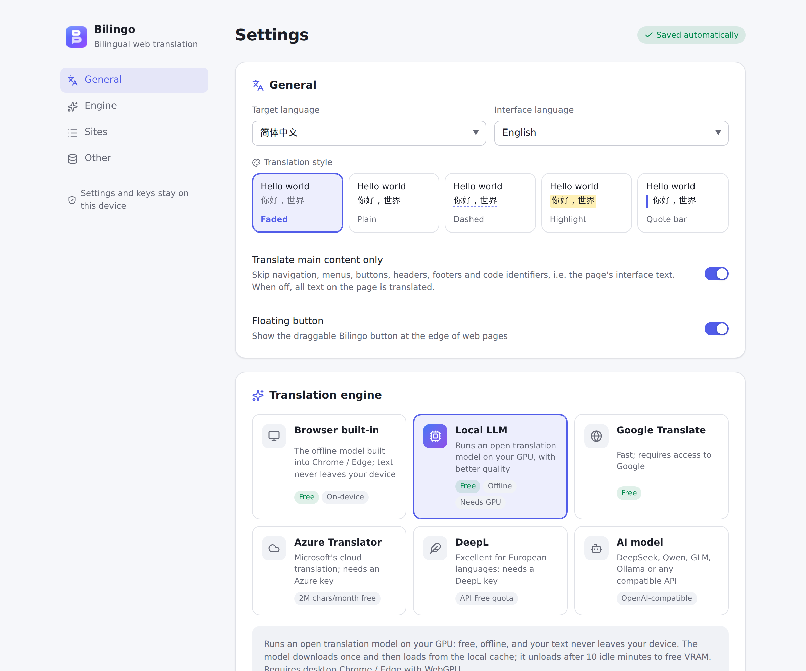
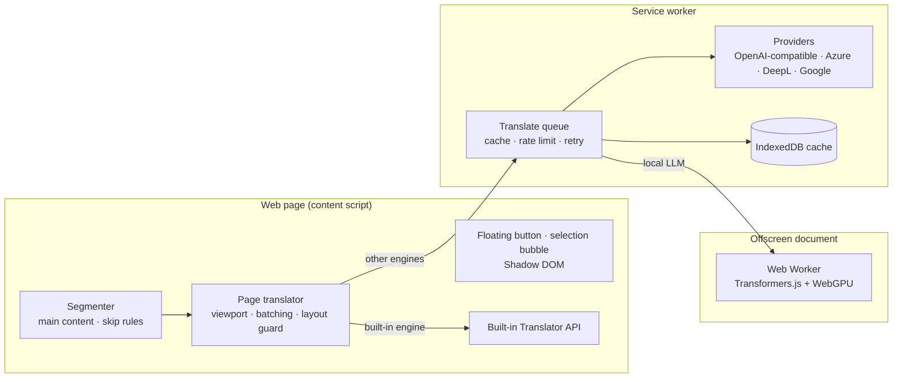

<p align="center">
  
</p>

<h1 align="center">Bilingo</h1>

<p align="center">
  <b>Read the web in two languages.</b><br>
  An open-source bilingual translation extension for Chrome, Edge and Safari: the translation appears right under each paragraph, and the original stays in place.
</p>

<p align="center">
  <a href="LICENSE"></a>
  <a href="https://github.com/wianger/bilingo/actions/workflows/ci.yml"></a>
  
  
</p>

<p align="center">
  English · <a href="README.zh-CN.md">简体中文</a>
</p>

<p align="center">
  
</p>

## Why Bilingo

Bilingual page translators are great for reading foreign-language content, but the popular ones lock AI translation behind a subscription. Bilingo is a free and open alternative: bring your own API key, run a translation model **on your own GPU**, or use the translator built into your browser. Your text never passes through a Bilingo server, because there isn't one.

## Features

- **Bilingual or original in one click.** Translations are inserted under each paragraph. Click the floating button, press <kbd>Alt</kbd>+<kbd>A</kbd>, or use the toolbar popup to switch back.
- **Translates what matters.** On articles (news, blogs, docs), the main content is detected with [Mozilla Readability](https://github.com/mozilla/readability), the engine behind Firefox Reader View. On other pages, navigation, menus, buttons, tag pills, link lists, code identifiers and screen-reader-only text are skipped.
- **Site rules you can point and click.** If a site translates the wrong things, open the popup, choose **Choose what to translate…**, click the area, and pick **Don't translate** or **Translate only this**. Rules are generated to match the same kind of area on every page of that site, and can be edited, imported and exported in settings.
- **PDF translation that keeps the layout.** PDFs open in Bilingo's reader with a translated copy of each page next to the original: every paragraph is replaced in place, while figures, formulas, tables and colours stay as they are. Switch between side by side, translation only and original; hover a paragraph to highlight its counterpart. Works for online PDFs (opened automatically if you enable it, or via the floating button in the browser's own PDF viewer) and local files (drag and drop).
- **YouTube bilingual subtitles.** Click the Bilingo button in the player's control bar to show the translation under the original subtitles, sentence by sentence, including auto-generated captions and fullscreen. It follows the caption track you pick in YouTube's CC menu and translates ahead as the video plays.
- **Never breaks layouts.** Before and after inserting a translation, Bilingo measures the surrounding containers. If a translation would overflow a fixed-size card or tab strip, it is withdrawn and shown on hover instead.
- **Lazy and cheap.** Only paragraphs near the viewport are translated, dynamic content is followed automatically, text that is already in your language is skipped, and every result is cached in IndexedDB.
- **Six engines**, from free and offline to the LLM of your choice (see below).
- **English and Chinese interface**, following your browser language or chosen in settings.
- **Selection translation** from the context menu, a draggable floating button, an "always translate this site" list, 5 translation styles, and light/dark themes.

<p align="center">
  
</p>

<p align="center">
  
  &nbsp;
  
</p>

## Translation engines

| Engine                            | Cost                                          | Notes                                                                                                                                                                                                                                                                                                                                                   |
| --------------------------------- | --------------------------------------------- | ------------------------------------------------------------------------------------------------------------------------------------------------------------------------------------------------------------------------------------------------------------------------------------------------------------------------------------------------------- |
| **Browser built-in AI** (default) | Free                                          | The on-device [Translator API](https://developer.chrome.com/docs/ai/translator-api) in Chrome 138+ / Edge 148+ desktop. Offline; text never leaves your device. Each language pair downloads a language pack on first use.                                                                                                                              |
| **Local LLM**                     | Free                                          | Runs an open translation model on your GPU with WebGPU: [Hy-MT2 1.8B](https://huggingface.co/tencent/Hy-MT2-1.8B) (recommended, ~1.1 GB, Apache-2.0), [TranslateGemma 4B](https://huggingface.co/onnx-community/translategemma-text-4b-it-ONNX) (experimental, ~3.1 GB), or any compatible ONNX model. Resumable downloads. Chrome / Edge desktop only. |
| **Any OpenAI-compatible API**     | Your own key (some providers have free tiers) | DeepSeek, Zhipu GLM, SiliconFlow, Alibaba Bailian, OpenRouter, OpenAI, Ollama and more. Batched JSON protocol with automatic per-item fallback; custom prompt / glossary.                                                                                                                                                                               |
| **Azure AI Translator**           | 2M chars / month free (F0 tier)               | Official API.                                                                                                                                                                                                                                                                                                                                           |
| **DeepL**                         | DeepL API Free quota                          | Official API.                                                                                                                                                                                                                                                                                                                                           |
| **Google Translate**              | Free                                          | Unofficial web endpoint.                                                                                                                                                                                                                                                                                                                                |

## Install

Bilingo is not on the extension stores yet. Build it from source:

```bash
git clone https://github.com/wianger/bilingo.git
cd bilingo
npm install
npm run build        # Chrome → .output/chrome-mv3
npm run build:edge   # Edge   → .output/edge-mv3
```

Then open `chrome://extensions` (or `edge://extensions`), turn on **Developer mode**, click **Load unpacked**, and pick the output folder.

<details>
<summary><b>Safari</b> (requires macOS and Xcode)</summary>

```bash
npm run build:safari                                     # → .output/safari-mv3
xcrun safari-web-extension-converter .output/safari-mv3  # creates an Xcode project; run it from Xcode
```

The Safari build uses a non-persistent background page instead of a service worker. Safari has neither the built-in Translator API nor the offscreen API, so the browser built-in engine and the local LLM are not available there yet. Use one of the other engines.

</details>

## Usage

| Action                          | How                                                                                                                      |
| ------------------------------- | ------------------------------------------------------------------------------------------------------------------------ |
| Translate / show original       | Click the floating Bilingo button, press <kbd>Alt</kbd>+<kbd>A</kbd>, or use the popup                                   |
| Translate a selection           | Select text → right-click → **Translate “…”**                                                                            |
| Translation that didn't fit     | Text with a dotted underline: hover to see its translation                                                               |
| Always translate a site         | Popup → **Always translate this site**                                                                                   |
| Fix what a site translates      | Popup → **Choose what to translate…** → click an area (or right-click → **Choose what to translate on this site**)       |
| YouTube bilingual subtitles     | Click the Bilingo button in the video player's control bar                                                               |
| Translate a PDF                 | Click the floating button on a PDF, or enable Settings → **Open online PDFs in Bilingo**; drop local files on the reader |
| Move the floating button        | Drag it; it snaps to the nearest edge and remembers its position                                                         |
| Change engine, style, shortcuts | Popup → ⚙ settings                                                                                                       |

> The interface is available in English and Simplified Chinese. It follows your browser language by default; change it in Settings → Interface language. Pages can be translated into 15 target languages. Want Bilingo in your language? See [CONTRIBUTING.md](CONTRIBUTING.md#translating-the-interface).

> **Note:** other extensions that also hook YouTube's caption requests (for example other bilingual-subtitle tools) can conflict with Bilingo's YouTube subtitles. If subtitles don't appear, try disabling them.

## Privacy

Bilingo has no backend and collects no analytics. Settings and API keys are stored only in your browser. Page text is sent only to the engine **you** choose, directly from your browser. The browser built-in engine and the local LLM never send text anywhere. See [PRIVACY.md](PRIVACY.md).

## Development

```bash
npm run dev            # dev mode with hot reload (opens Chrome)
npm run dev:edge       # same, in Edge
npm test               # unit tests (Vitest)
npm run test:e2e       # build + end-to-end tests in a real Chromium (Playwright)
npm run check          # type check (svelte-check)
npm run lint           # ESLint (type-aware + Svelte)
npm run format         # Prettier
npm run icons          # regenerate PNG icons from assets/logo.svg
npm run screenshots    # regenerate README screenshots (after npm run build)
npm run zip            # store-ready zip
```

### Architecture



```
src/
├─ entrypoints/   background, content script, popup, options, offscreen document
├─ content/       segmenter, main-content detection, page translator, floating UI
├─ background/    translation queue, IndexedDB cache, HTTP retry, providers
├─ local-llm/     WebGPU worker, model presets, prompts, resumable downloads
├─ pdf/           PDF reader (pdf.js), paragraph detection, PDF link redirect
├─ subtitles/     YouTube caption parsing, sentence building, overlay
├─ shared/        settings, languages, typed messaging, built-in AI wrapper
├─ assets/        design system CSS for the popup and settings pages
└─ ui/            shared UI helpers (engine icons)
```

Highlights:

- **Local LLM** runs in a Web Worker inside an offscreen document, so one model instance is shared by all tabs. It unloads after 10 idle minutes to free VRAM. Weights download in 16 MB HTTP Range chunks stored in Cache Storage, so an interrupted 1 GB download resumes where it stopped. ONNX Runtime's WebAssembly is bundled, because extensions may not load remote code.
- **Main-content detection** runs Readability on a clone of the page and maps the result back to the live DOM through index attributes. The region is widened to include the headline when that adds little extra text.
- **Layout guard**: overflow of nearby containers is measured before and after inserting a batch (two layouts per batch). Any translation that causes overflow becomes a hover hint.
- **PDF**: pdf.js renders the original; for each rendered page Bilingo copies the canvas into a second page, rebuilds paragraphs from the text items' geometry (lines → paragraphs, with first-line and hanging indents, inline-formula fragments, hyphenation; formulas, figure labels and author lines are skipped) and covers each paragraph with a box in the sampled background and text colour holding the translation, shrinking the font to fit. Online PDFs are redirected with `declarativeNetRequest` response-header rules, the same way Mozilla's pdf.js extension does it (Chrome/Edge 128+).
- **Security**: translations are inserted with `textContent`, never as HTML.

### Tech stack

[WXT](https://wxt.dev) (Manifest V3, cross-browser incl. Safari) · [Svelte 5](https://svelte.dev) · TypeScript 6 · [Transformers.js](https://github.com/huggingface/transformers.js) v4 + WebGPU · [Mozilla Readability](https://github.com/mozilla/readability) · [PDF.js](https://mozilla.github.io/pdf.js/) · [@webext-core/messaging](https://webext-core.aklinker1.io/) · [idb](https://github.com/jakearchibald/idb) · [Lucide](https://lucide.dev) · Vitest · Playwright · ESLint · Prettier.

The UI uses modern native CSS (OKLCH colors, `light-dark()`, customizable `<select>`, `@starting-style`) rather than a CSS framework, because the in-page UI lives in Shadow DOM and extension pages only run in evergreen browsers.

## Roadmap

- [x] Interface localization (English and Simplified Chinese)
- [ ] Publish to the Chrome Web Store and Edge Add-ons
- [ ] Local LLM on Safari (Safari 26 supports WebGPU)
- [x] Per-site rules (point-and-click, include / exclude / CSS)
- [x] YouTube bilingual subtitles
- [ ] Subtitles on other video sites
- [x] PDF translation (layout-preserving, in the browser)
- [ ] Download the translated PDF
- [ ] Optional AI layout model (e.g. DocLayout-YOLO on WebGPU) for complex PDFs

## Contributing

Bug reports, site-specific issues ("this page translates badly") and pull requests are welcome. See [CONTRIBUTING.md](CONTRIBUTING.md).

## Acknowledgements

Inspired by [Immersive Translate](https://immersivetranslate.com) and [Read Frog](https://github.com/mengxi-ream/read-frog). Built on [Transformers.js](https://github.com/huggingface/transformers.js), [ONNX Runtime Web](https://onnxruntime.ai), [Mozilla Readability](https://github.com/mozilla/readability) and [WXT](https://wxt.dev). Local models by [Tencent Hunyuan](https://huggingface.co/tencent/Hy-MT2-1.8B) and [Google](https://huggingface.co/google/translategemma-4b-it).

## License

[MIT](LICENSE) © 2026 Bilingo contributors
