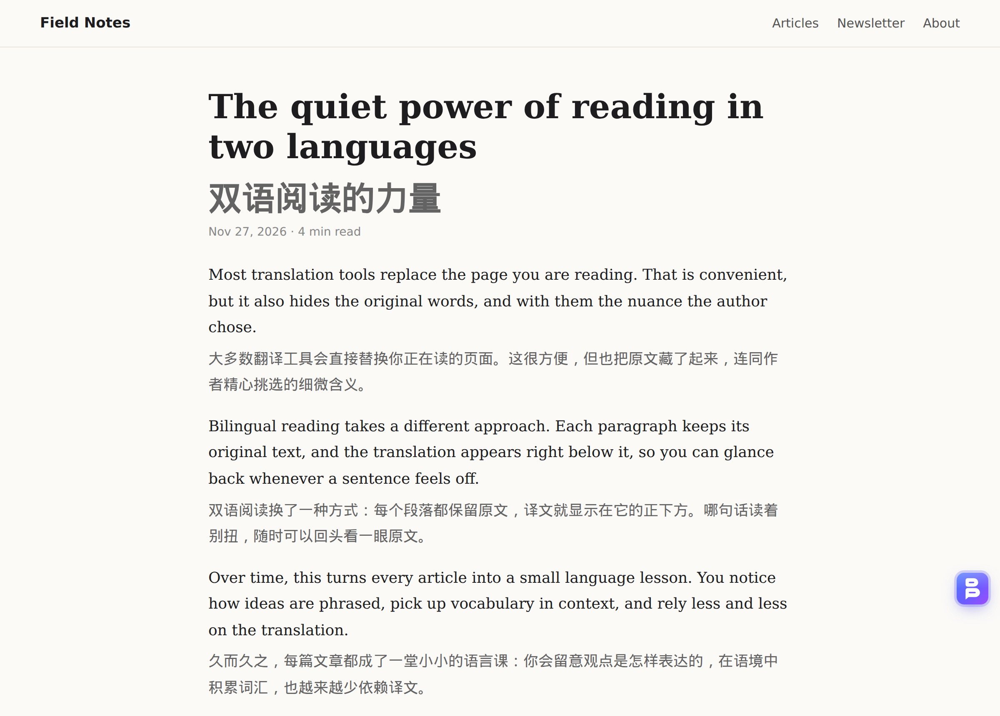
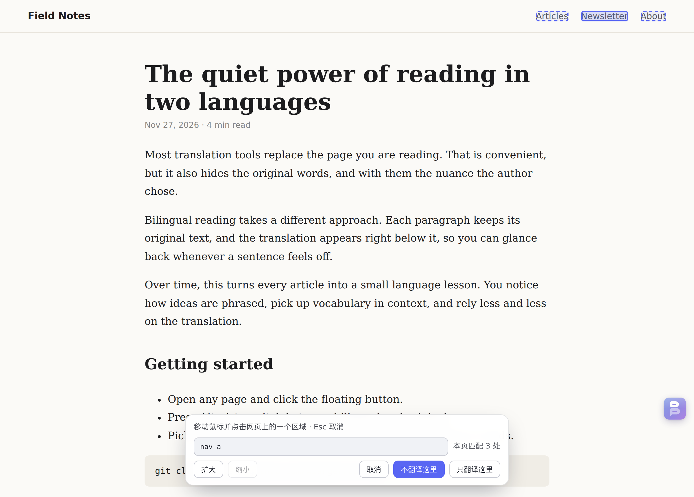
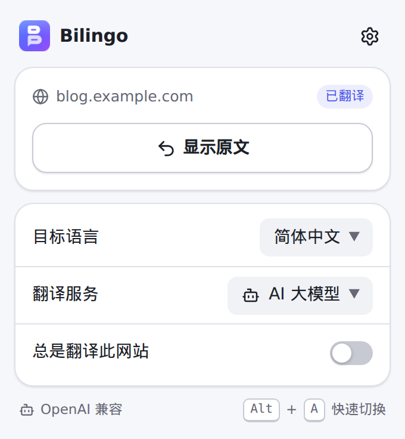
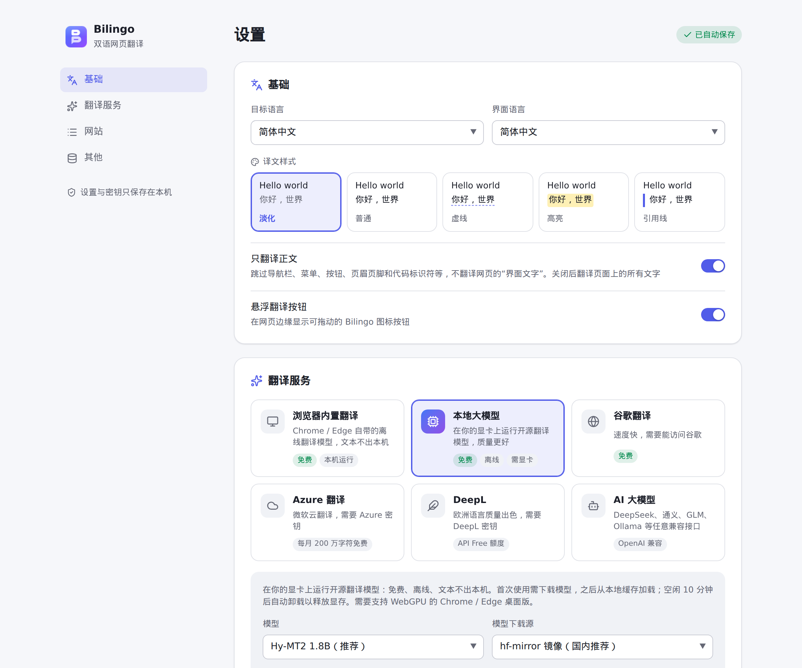
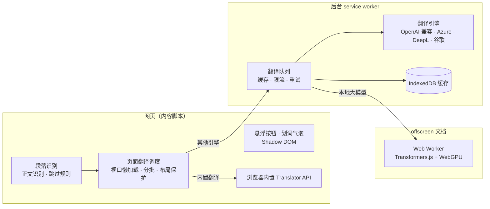

<p align="center">
  
</p>

<h1 align="center">Bilingo</h1>

<p align="center">
  <b>用两种语言读网页。</b><br>
  开源的双语对照网页翻译扩展，支持 Chrome、Edge、Safari。译文显示在每段原文下方，原文保持不动。
</p>

<p align="center">
  <a href="LICENSE"></a>
  <a href="https://github.com/wianger/bilingo/actions/workflows/ci.yml"></a>
  
  
</p>

<p align="center">
  <a href="README.md">English</a> · 简体中文
</p>

<p align="center">
  
</p>

## 为什么做 Bilingo

双语对照翻译很适合阅读外文内容，但主流产品把 AI 翻译放进了付费订阅。Bilingo 是免费、开源的替代品：可以用你自己的 API Key，可以**在自己的显卡上**运行翻译模型，也可以直接用浏览器内置的翻译。Bilingo 没有服务器，你的文本不会经过任何“Bilingo 后台”。

## 功能

- **一键切换双语 / 原文**：译文插在每段原文下方。点悬浮按钮、按 <kbd>Alt</kbd>+<kbd>A</kbd>，或在工具栏弹窗里切换。
- **只翻译该翻译的**：文章类网页（新闻、博客、文档）先用 [Mozilla Readability](https://github.com/mozilla/readability)（Firefox 阅读模式的算法）识别正文；其他网页跳过导航、菜单、按钮、标签胶囊、链接列表、代码标识符和读屏专用的隐藏文字。
- **点选即可修正的网站规则**：某个网站翻得不对时，在弹窗点 **选择翻译区域…**，在网页上点一下那块区域，选 **不翻译这里** 或 **只翻译这里**。生成的规则会匹配该网站所有页面上的同类区域，也可以在设置里编辑、导入、导出。
- **保留排版的 PDF 翻译**：PDF 在 Bilingo 阅读器里打开，每页旁边是一份翻译后的副本：每个段落原地替换为译文，图片、公式、表格和颜色保持原样。可以切换双语对照、仅译文、仅原文；鼠标悬停时两边对应的段落同时高亮。支持在线 PDF（可设置为自动打开，或在浏览器自带的 PDF 查看器里点悬浮按钮）和本地文件（拖进阅读器即可）。可以下载译文 PDF 或双语对照 PDF（文字可选中、可搜索）。可选的 **AI 版面分析**（PP-DocLayoutV3，WebGPU 本地运行，约 66MB）能识别正文、标题、图注、公式、表格和页眉页脚，公式和表格不会被误翻译。
- **YouTube 双语字幕**：点播放器控制栏里的 Bilingo 按钮，原字幕下方就会逐句显示译文，支持自动生成的字幕和全屏。跟随你在 YouTube 字幕菜单里选的轨道，并随播放进度提前翻译。
- **其他视频网站的双语字幕**：适用于提供 HTML5 字幕轨道的播放器（Vimeo、Plyr、`<track>` 元素、不少课程平台）：鼠标移到视频上，点角落里的 Bilingo 按钮，跟随你在播放器里选的字幕轨道。自己绘制字幕、不公开字幕数据的播放器（Netflix、TED、哔哩哔哩）暂不支持。
- **不破坏网页布局**：插入译文前后测量周围容器。如果译文会让固定尺寸的卡片、标签条溢出，就撤回译文，改为虚线提示，鼠标悬停显示。
- **省钱**：只翻译进入视口附近的段落，自动跟随动态加载的内容，跳过已是目标语言的段落，翻译结果缓存在本地（IndexedDB），同一段文字不重复花钱。
- **6 种翻译引擎**：从免费离线到任选大模型，见下表。
- **中英文界面**：默认跟随浏览器语言，也可在设置中切换。
- 右键划词翻译、可拖动的悬浮按钮、“总是翻译此网站”、5 种译文样式、浅色 / 深色模式。

<p align="center">
  
</p>

<p align="center">
  
  &nbsp;
  
</p>

## 翻译引擎

| 引擎                      | 费用                           | 说明                                                                                                                                                                                                                                                                                                                       |
| ------------------------- | ------------------------------ | -------------------------------------------------------------------------------------------------------------------------------------------------------------------------------------------------------------------------------------------------------------------------------------------------------------------------- |
| **浏览器内置 AI**（默认） | 免费                           | Chrome 138+ / Edge 148+ 桌面版自带的本地模型（[Translator API](https://developer.chrome.com/docs/ai/translator-api)），不联网、文本不出本机。每个语言对首次使用需下载语言包                                                                                                                                                |
| **本地大模型**            | 免费                           | 用 WebGPU 在你的显卡上运行开源翻译模型：[Hy-MT2 1.8B](https://huggingface.co/tencent/Hy-MT2-1.8B)（推荐，约 1.1 GB，Apache-2.0）、[TranslateGemma 4B](https://huggingface.co/onnx-community/translategemma-text-4b-it-ONNX)（实验性，约 3.1 GB）或自定义模型。默认走 hf-mirror 镜像，支持断点续传；仅 Chrome / Edge 桌面版 |
| **任意 OpenAI 兼容接口**  | 自带 Key（部分平台有免费额度） | DeepSeek、智谱 GLM、硅基流动、阿里百炼、OpenRouter、OpenAI、Ollama 等。批量 JSON 协议，漏译自动逐条补译；可自定义提示词 / 术语表                                                                                                                                                                                           |
| **Azure AI 翻译**         | 每月 200 万字符免费（F0）      | 官方 API                                                                                                                                                                                                                                                                                                                   |
| **DeepL**                 | DeepL API Free 免费额度        | 官方 API                                                                                                                                                                                                                                                                                                                   |
| **谷歌翻译**              | 免费                           | 非官方网页接口，国内网络需要代理                                                                                                                                                                                                                                                                                           |

> 曾经流行的微软 Edge 免费翻译接口（`edge.microsoft.com/translate/auth`）已于 2026 年 8 月前后失效，因此没有接入。

## 安装

暂未上架扩展商店，需要从源码构建：

```bash
git clone https://github.com/wianger/bilingo.git
cd bilingo
npm install
npm run build        # Chrome → .output/chrome-mv3
npm run build:edge   # Edge   → .output/edge-mv3
```

打开 `chrome://extensions`（或 `edge://extensions`），开启 **开发者模式**，点 **加载已解压的扩展程序**，选择上面的输出文件夹。

<details>
<summary><b>Safari</b>（需要 macOS 和 Xcode）</summary>

```bash
npm run build:safari                                     # → .output/safari-mv3
xcrun safari-web-extension-converter .output/safari-mv3  # 生成 Xcode 工程，在 Xcode 中运行
```

Safari 版后台使用非持久后台页，而不是 service worker。Safari 没有内置 Translator API，所以不能用浏览器内置翻译。本地大模型运行在后台页面里的隐藏框架中（Safari 没有 offscreen API），需要 WebGPU（Safari 26 及以上）。维护者没有 Mac，Safari 在 GitHub 的 macOS 机器上验证（[Safari / WebKit 工作流](.github/workflows/safari.yml)）：用 Xcode 转换并编译扩展，并在 WebKit 里实际运行本地大模型的代码路径（框架 → Worker → Transformers.js → WebGPU）完成翻译。这些虚拟机上的真实 Safari 拿不到 GPU，所以还没有在真实的 Mac 上完整测试过，欢迎反馈。

</details>

## 使用

| 操作                   | 方法                                                                               |
| ---------------------- | ---------------------------------------------------------------------------------- |
| 翻译 / 显示原文        | 点网页上的 Bilingo 悬浮按钮，按 <kbd>Alt</kbd>+<kbd>A</kbd>，或用弹窗              |
| 划词翻译               | 选中文字 → 右键 → **翻译“…”**                                                      |
| 放不下的译文           | 带虚线下划线的文字：鼠标悬停查看译文                                               |
| 总是翻译某个网站       | 弹窗 → **总是翻译此网站**                                                          |
| 修正某个网站翻译的范围 | 弹窗 → **选择翻译区域…** → 点选区域（或右键 → **设置此网站的翻译区域**）           |
| YouTube 双语字幕       | 点视频播放器控制栏里的 Bilingo 按钮                                                |
| 翻译 PDF               | 在 PDF 上点悬浮按钮，或开启 设置 → **用 Bilingo 打开在线 PDF**；本地文件拖进阅读器 |
| 下载翻译后的 PDF       | PDF 阅读器 → ⬇ → **译文 PDF** / **双语 PDF**，在打印对话框里选“另存为 PDF”         |
| 其他视频网站的字幕     | 先在播放器里打开字幕，鼠标移到视频上，点角落里的 Bilingo 按钮                      |
| 移动悬浮按钮           | 直接拖动，松开后吸附到最近的边缘，并记住位置                                       |
| 换引擎、样式、快捷键   | 弹窗 → ⚙ 设置                                                                      |

> **注意**：其他同样会拦截 YouTube 字幕请求的扩展（例如其他双语字幕工具）可能与 Bilingo 的 YouTube 字幕冲突。如果字幕不显示，可以先停用它们试试。

## 隐私

Bilingo 没有服务器，不收集任何统计数据。设置和 API Key 只保存在你的浏览器里。网页文字只会从你的浏览器直接发给**你选择的**翻译引擎；浏览器内置翻译和本地大模型不会把文字发到任何地方。详见 [PRIVACY.md](PRIVACY.md)。

## 开发

```bash
npm run dev            # 开发模式，热更新（自动打开 Chrome）
npm run dev:edge       # 同上，使用 Edge
npm test               # 单元测试（Vitest）
npm run test:e2e       # 构建后在真实 Chromium 中跑端到端测试（Playwright）
npm run check          # 类型检查（svelte-check）
npm run lint           # ESLint（类型感知 + Svelte）
npm run format         # Prettier 格式化
npm run icons          # 由 assets/logo.svg 重新生成 PNG 图标
npm run screenshots    # 重新生成 README 截图（先 npm run build）
npm run zip            # 打包上架用的 zip
```

### 架构



```
src/
├─ entrypoints/   后台、内容脚本、弹窗、设置页、offscreen 文档
├─ content/       段落识别、正文识别、页面翻译调度、悬浮 UI
├─ background/    翻译队列、IndexedDB 缓存、HTTP 重试、各翻译引擎
├─ local-llm/     WebGPU Worker、模型列表、提示词、断点续传下载
├─ pdf/           PDF 阅读器（pdf.js）、段落识别、在线 PDF 跳转
├─ subtitles/     YouTube 字幕解析、断句、字幕层
├─ shared/        设置、语言表、类型化消息、内置 AI 封装
├─ assets/        弹窗和设置页的设计系统 CSS
└─ ui/            共用 UI 辅助（引擎图标）
```

要点：

- **本地大模型**运行在 offscreen 文档里的 Web Worker 中，所有标签页共用一份模型，空闲 10 分钟自动卸载以释放显存。模型按 16 MB 分块用 HTTP Range 下载并存入 Cache Storage，1 GB 的下载中断后可从断点继续。ONNX Runtime 的 WebAssembly 随扩展打包，因为扩展不允许加载远程代码。
- **正文识别**：在网页副本上运行 Readability，再通过序号属性把结果对应回真实网页；如果多出的文字不多，就把识别区域扩展到包含文章标题。
- **布局保护**：每批译文插入前后各测量一次附近容器的溢出量（每批只触发两次排版），会造成溢出的译文改为悬停显示。
- **PDF**：pdf.js 渲染原文；每页渲染完成后，把画面复制到旁边的译文页，按文字的几何位置还原段落（行 → 段落，处理首行缩进、悬挂缩进、行内公式碎片和连字符断词；跳过公式、图中标注和作者信息），再用取样得到的底色和文字颜色，在每个段落的位置盖上写有译文的方块，放不下时缩小字号。在线 PDF 通过 `declarativeNetRequest` 的响应头规则跳转，做法与 Mozilla 官方的 pdf.js 扩展相同（Chrome / Edge 128+）。
- **安全**：译文一律以 `textContent` 插入，不会被当作 HTML 执行。

### 技术栈

[WXT](https://wxt.dev)（Manifest V3，跨浏览器含 Safari）· [Svelte 5](https://svelte.dev) · TypeScript 6 · [Transformers.js](https://github.com/huggingface/transformers.js) v4 + WebGPU · [Mozilla Readability](https://github.com/mozilla/readability) · [PDF.js](https://mozilla.github.io/pdf.js/) · [@webext-core/messaging](https://webext-core.aklinker1.io/) · [idb](https://github.com/jakearchibald/idb) · [Lucide](https://lucide.dev) · Vitest · Playwright · ESLint · Prettier。

界面没有用 CSS 框架，而是用现代原生 CSS（OKLCH 色彩、`light-dark()`、可定制 `<select>`、`@starting-style`）：网页内的界面在 Shadow DOM 里，而扩展页面只运行在新版浏览器中。

## 路线图

- [x] 界面多语言（英文、简体中文）
- [ ] 上架 Chrome 应用商店和 Edge 加载项商店
- [x] Safari 上的本地大模型（已在 CI 的 WebKit 中验证，尚需在真实 Mac 上测试）
- [x] 按网站自定义规则（网页上点选，翻译 / 不翻译 / CSS）
- [x] YouTube 双语字幕
- [x] 其他视频网站的字幕（HTML5 字幕轨道）
- [ ] 为隐藏字幕数据的播放器做适配（Netflix、TED、哔哩哔哩）
- [x] PDF 翻译（保留排版，在浏览器内完成）
- [x] 下载译文 / 双语 PDF
- [x] 可选的 AI 版面分析（WebGPU 上的 PP-DocLayoutV3）

## 参与贡献

欢迎提交问题、反馈“某个网站翻得不好”，或直接提 Pull Request。请先看 [CONTRIBUTING.md](CONTRIBUTING.md)。

## 致谢

灵感来自 [沉浸式翻译](https://immersivetranslate.com) 和 [Read Frog](https://github.com/mengxi-ream/read-frog)。基于 [Transformers.js](https://github.com/huggingface/transformers.js)、[ONNX Runtime Web](https://onnxruntime.ai)、[Mozilla Readability](https://github.com/mozilla/readability)、[PDF.js](https://mozilla.github.io/pdf.js/) 和 [WXT](https://wxt.dev) 构建。本地模型来自 [腾讯混元](https://huggingface.co/tencent/Hy-MT2-1.8B) 和 [Google](https://huggingface.co/google/translategemma-4b-it)；PDF 版面分析模型 [PP-DocLayoutV3](https://huggingface.co/PaddlePaddle/PP-DocLayoutV3_onnx) 来自飞桨（Apache-2.0，[WebGPU 版导出](https://huggingface.co/traceray/nexus-layout)）。保留排版的 PDF 翻译思路参考了 [BabelDOC](https://github.com/funstory-ai/BabelDOC) / [PDFMathTranslate](https://github.com/PDFMathTranslate/PDFMathTranslate)。

## 许可证

[MIT](LICENSE) © 2026 Bilingo contributors
